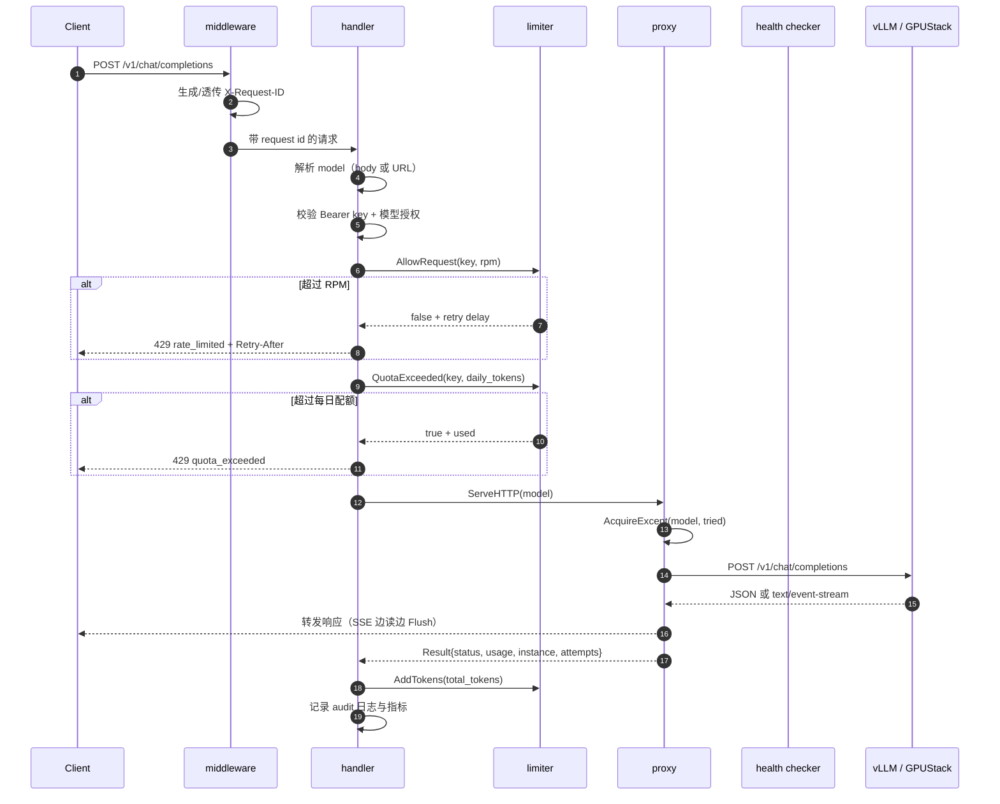

# Model Gateway 架构设计

本文描述 `model-gateway` 当前的实现边界、关键机制，以及它与 `oyyyyy61` 其他仓库
（`alertment`、`Prometheus`、`ai-job-Operator`、`skilling`）的组合方式。

## 1. 定位

`model-gateway` 是 GPU 集群上大模型服务的统一入口：

- 对业务方提供 OpenAI 兼容的 `/v1/chat/completions` 与 `/v1/models`。
- 对内屏蔽 vLLM / GPUStack 多实例、多副本、扩缩容和故障。
- 提供租户级 API Key、模型授权、RPM 限流、每日 token 配额和审计日志。
- 输出 Prometheus 指标，配合 `alertment` 的告警链路和飞书通知。
- 与 `ai-job-Operator` 共用一套 GPU 集群标签与观测约定。

当前版本是**单进程、无外部依赖**的实现：密钥、限流状态和用量都在内存中。这样
可以独立跑通、压测和演示；多副本共享状态放在路线图的 P1。

## 2. 总体架构

```mermaid
flowchart LR
    subgraph Clients[业务方]
        SDK[OpenAI SDK / curl]
        EVAL[skilling 评测任务]
    end

    subgraph Gateway[model-gateway]
        MW[middleware<br/>request id / recovery / access log]
        H[handler<br/>auth / rpm / quota / models / admin]
        P[proxy<br/>weighted pick / failover / SSE]
        HC[health checker]
        AU[(API key store<br/>in-memory)]
        LIM[(limiter<br/>token bucket + daily tokens)]
        MET[/metrics]
    end

    subgraph Serving[模型服务层]
        GS[GPUStack Server]
        V1[vLLM 实例 A]
        V2[vLLM 实例 B]
        JOB[AIJob<br/>Volcano PodGroup]
    end

    subgraph Ops[可观测性]
        PR[Prometheus]
        AM[Alertmanager]
        FS[feishu-adapter]
        GF[Grafana]
    end

    SDK -->|Bearer key| MW --> H --> P
    EVAL -->|Bearer key| MW
    H --> AU
    H --> LIM
    P --> V1
    P --> V2
    GS -.模型发现/生命周期.-> V1
    GS -.模型发现/生命周期.-> V2
    JOB -.GPU 资源竞争.-> Serving
    MET --> PR
    HC --> PR
    PR --> AM --> FS
    PR --> GF
```

部署形态：

| 形态 | 状态 | 说明 |
| --- | --- | --- |
| 本地 / Docker Compose | 支持 | gateway + 两个 mock 模型实例 |
| Kubernetes 单副本 / 多副本 | 支持 | Deployment + Service + HPA，见 `deploy/k8s` |
| 多副本共享限流/配额 | P1 | 需要 Redis；当前为进程内状态 |
| 密钥与审计持久化 | P1 | 迁移文件已就绪，当前为环境变量 + 结构化日志 |

## 3. 请求生命周期



关键顺序：**先认证、再授权、再限流/配额、最后选实例**。这样未授权的请求不会
消耗配额，也不会打到模型实例。

## 4. 代码模块

| 包 | 职责 |
| --- | --- |
| `internal/config` | 环境变量解析、默认值、非法值过滤 |
| `internal/auth` | Key 哈希、Bearer 解析、租户与模型授权 |
| `internal/limits` | RPM 令牌桶、每日 token 计数与配额判断 |
| `internal/routing` | 平滑加权轮询、并发信号量、健康状态、排除重试 |
| `internal/health` | 后台健康探测、失败下线、连续成功恢复 |
| `internal/usage` | 从 JSON / SSE 响应中提取 token usage |
| `internal/metrics` | 无第三方依赖的 Prometheus 文本指标 |
| `internal/gateway` | HTTP handler、代理、故障转移、审计日志 |
| `internal/middleware` | request id、panic recovery、访问日志 |
| `internal/version` | 构建版本（可用 ldflags 覆盖） |

## 5. 关键机制

### 5.1 认证与授权

- Key 只以 SHA-256 哈希形式保存在内存，日志只输出 `key_id`（名称或前 8 位）。
- `MGW_API_KEYS` 每项为 `token|tenant|models|rpm|daily_tokens|name`；`models` 用
  逗号分隔，`*` 表示全部模型。
- 每次认证对全部 Key 做恒定时间比较，Key 数量建议控制在几十个以内；更大规模
  应改用 MySQL/Redis 存储（迁移文件已包含 `api_keys`、`tenants`、`tenant_models`）。
- 上游请求会删除 `Authorization`，避免租户 Key 泄露给模型服务。

### 5.2 限流与配额

- **RPM**：每个 Key 一个容量为 `rpm` 的令牌桶，按 `rpm/60` 每秒补充。允许突发
  `rpm` 个请求，超过后返回 `429` 与 `Retry-After`。
- **每日 token**：按 UTC 自然日累计上游返回的 `total_tokens`。请求前检查是否
  已达上限，响应后累加。这是**软配额**：并发请求可能同时通过检查，精确扣减需要
  Redis 原子操作。
- 进程重启会丢失当天的计数；需要跨重启一致性时启用 P1 的 Redis/MySQL 实现。

### 5.3 路由与并发

- 同一模型可配置多个实例，`MGW_UPSTREAMS` 每项为
  `id|model|endpoint|weight|max_inflight`。
- 选择算法为平滑加权轮询（Nginx 风格），过滤不健康、并发已满、本次已重试过的
  实例。
- `max_inflight` 用带缓冲 channel 做信号量，`defer release()` 保证成功、超时、
  取消、异常路径都会归还额度。
- 端点必须是 OpenAI 兼容 API 的根地址（例如 `http://vllm:8000`）。网关统一转发
  到 `/v1/chat/completions`，因此 vLLM、GPUStack、mock 都能直接接入。

### 5.4 健康检查

- 启动后立即探测一次，之后每 `MGW_HEALTH_INTERVAL` 探测
  `endpoint + MGW_HEALTH_PATH`（vLLM 用 `/health`，mock 用 `/healthz`）。
- 连续失败 `MGW_HEALTH_FAILURES` 次 → 下线；连续成功
  `MGW_HEALTH_SUCCESSES` 次 → 恢复，避免抖动。
- 代理遇到连接错误会立即把实例标记为不健康（快速失败），恢复仍由后台探测负责。
- `/readyz` 在所有实例都不健康时返回 `503`，可直接作为 K8s readinessProbe。

### 5.5 故障转移

- 重试只发生在**响应开始之前**：连接错误，或上游返回 `502/503/504`。
- 最多 `MGW_RETRY_ATTEMPTS` 次，每次排除已尝试的实例；不会重复打同一个实例。
- SSE 一旦开始向客户端写入，就不再重试、不再写 JSON 错误，避免污染流。
- 所有实例都不可用时返回 `503 upstream_unavailable`。

### 5.6 用量与审计

- 非流式响应解析 JSON 的 `usage` 字段。
- 流式响应逐行扫描 `data:` 事件，取最后一个 `usage` 对象。上游需要支持
  `stream_options.include_usage`（vLLM 支持；mock 已模拟）。
- 审计日志为结构化 JSON（`msg="request audit"`），包含 request id、租户、Key、
  模型、实例、尝试次数、状态、耗时、首字节、字节数、prompt/completion/total
  tokens。**不记录 prompt 与回答正文**。
- `request_audits` 表和 `audit` 写入器是 P1 的持久化落点。

### 5.7 指标

| 指标 | 类型 | 标签 | 含义 |
| --- | --- | --- | --- |
| `gateway_requests_total` | counter | model, tenant, status | 请求结果 |
| `gateway_request_duration_seconds` | histogram | model | 端到端耗时 |
| `gateway_tokens_total` | counter | tenant, model, kind | prompt/completion/total |
| `gateway_inflight_requests` | gauge | model | 处理中的请求 |
| `gateway_upstream_healthy` | gauge | instance, model | 实例是否健康 |
| `gateway_rate_limited_total` | counter | tenant, reason | 限流/配额拒绝 |
| `gateway_upstream_failures_total` | counter | instance | 连接失败 |
| `gateway_health_checks_total` | counter | instance, result | 健康探测结果 |
| `gateway_build_info` | gauge | version | 构建版本 |

指标刻意只使用 model/tenant/instance 三类标签，避免租户数增长导致时间序列爆炸。

## 6. 与其他仓库的整合

| 仓库 | 已有资产 | 在网关中的用法 | 阶段 |
| --- | --- | --- | --- |
| [`alertment`](https://github.com/oyyyyy61/alertment) | PrometheusRule、AlertmanagerConfig、飞书适配器、Grafana 面板、GPU 标签约定 | 复用告警规则与 `category` 路由；飞书适配器直接消费网关告警；Grafana 仪表盘见 `deploy/k8s/grafana-dashboard.yaml` | P0/P3 |
| [`Prometheus`](https://github.com/oyyyyy61/Prometheus) | vLLM/NPU 指标桥、KV cache 与 token 指标、恢复控制器、预算化观测研究 | 网关 token/请求指标与 vLLM 指标关联，定位"网关有流量但模型无吞吐"类问题；恢复控制器面向训练任务，不直接接管网关 | P2/P3 |
| [`ai-job-Operator`](https://github.com/oyyyyy61/ai-job-Operator) | AIJob CRD、Volcano PodGroup、GPU 注入、优先级 | 在线推理（gateway）与离线任务（AIJob）共享 GPU 池；用 `observability.gpustack.io/owner`、`team`、`task` 标签统一归属；后续把模型加载/卸载做成 AIJob 的一种 | P2 |
| [`skilling`](https://github.com/oyyyyy61/skilling) | Agent/Skill 评测框架、长上下文与污染实验 | 评测任务作为独立租户调用网关，用 RPM/token 配额隔离实验流量与线上流量 | P1/P3 |

### 6.1 与 alertment 的告警链路

```text
gateway /metrics
  → Prometheus（PodMonitor / static_config）
  → PrometheusRule（deploy/k8s/prometheusrule.yaml）
  → Alertmanager
  → alertmanager-feishu-adapter.gpu-observability:8080/alerts
  → 飞书群
```

告警统一带 `category: model-gateway` 标签，`alertment` 的 AlertmanagerConfig 根路由
只匹配 `category=~.+`，因此无需修改现有路由即可接入。飞书适配器会按告警级别、
实例和摘要生成中文消息。

### 6.2 与 GPUStack / vLLM 的接入

1. GPUStack 负责模型下载、实例加载和生命周期；vLLM 暴露 OpenAI 兼容 API。
2. 在 `MGW_UPSTREAMS` 中为每个可服务实例配置一条记录，`endpoint` 指向实例根地址。
3. `MGW_HEALTH_PATH` 按运行时选择：vLLM 用 `/health`，GPUStack 视版本使用
   `/health` 或 `/v1/models`。
4. 网关只做路由和治理，不参与模型加载；模型冷启动期间的 503 由健康检查自动恢复。

## 7. 失败模式

| 现象 | 网关行为 | 排查入口 |
| --- | --- | --- |
| 上游连接拒绝/超时 | 标记实例不健康，重试其他实例；全部失败返回 503 | `gateway_upstream_failures_total`、audit 日志 |
| 上游 5xx | 响应未开始时重试；否则原样转发 5xx | `gateway_requests_total{status="upstream_5xx"}` |
| SSE 中途断开 | 已开始的响应直接结束，不写 JSON 错误 | audit 日志 `stream=true`、客户端断开 |
| 客户端取消 | 返回 499 语义，取消上游 context | `client_cancelled` |
| RPM 超限 | 429 + `Retry-After` | `gateway_rate_limited_total{reason="rpm"}` |
| 每日配额耗尽 | 429 `quota_exceeded` | `gateway_rate_limited_total{reason="daily_tokens"}` |
| 全部实例不健康 | `/readyz` 503，请求 503 | `gateway_upstream_healthy`、`gateway_health_checks_total` |
| 请求体过大 | 413 | `request_too_large` |

## 8. 安全边界

- 生产环境必须在 Ingress/网关外层终止 TLS；本服务只监听 HTTP。
- `MGW_API_KEYS` 与 `MGW_ADMIN_TOKEN` 通过 Secret 注入，不写入 ConfigMap 或镜像。
- `/admin/status` 未配置 token 时直接 404；配置后使用恒定时间比较。
- 上游请求移除 `Authorization`，保留 `X-Request-ID` 便于链路追踪。
- 请求体默认上限 10 MiB（`MGW_MAX_BODY_BYTES`），防止内存放大。
- 审计日志不落 prompt/回答正文；如未来需要内容审计，应单独做脱敏与保留策略。
- 当前 Key 存储在内存，进程转储可能包含哈希而非明文；仍建议限制容器权限。

## 9. 后续

分阶段任务、验收标准和仓库映射见 [roadmap.md](roadmap.md)。
